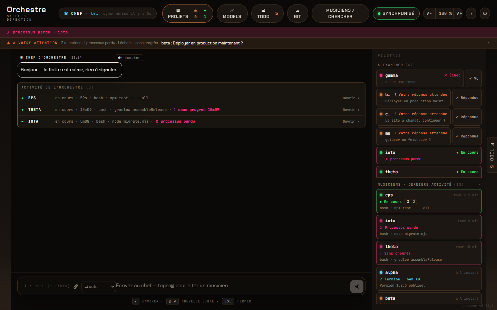
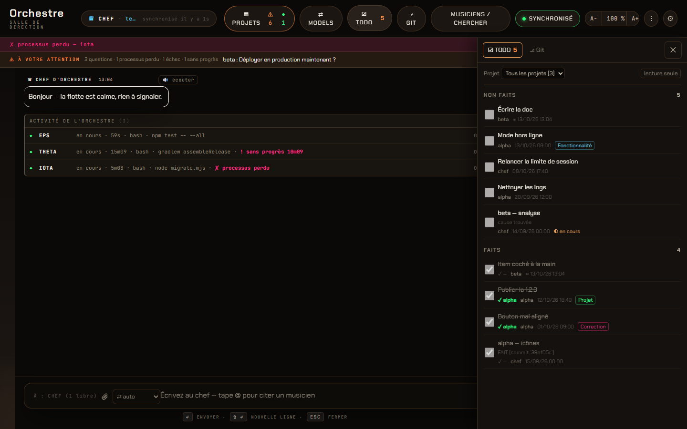
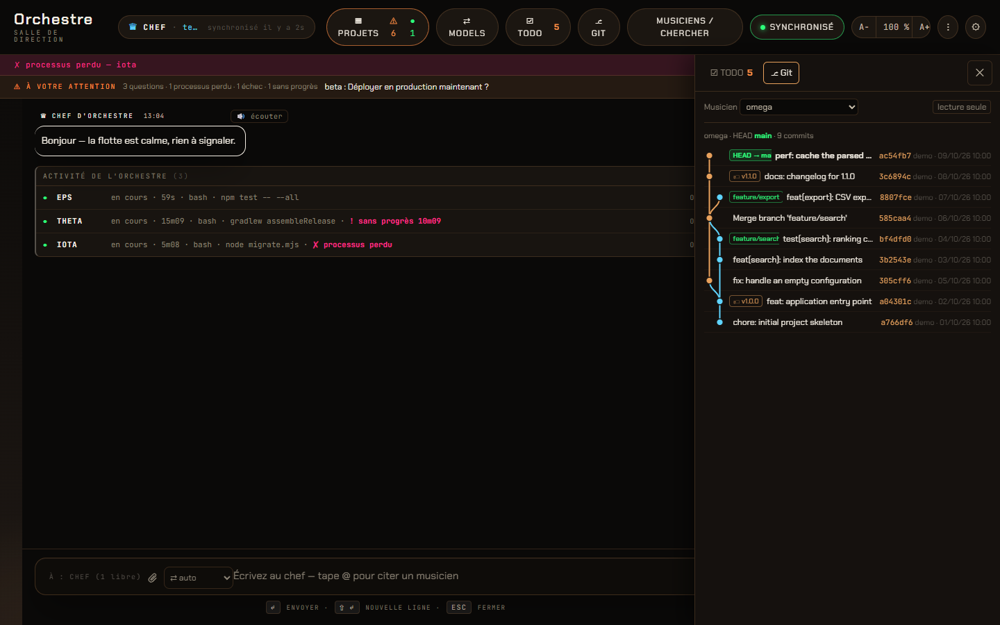

# orchestrateur (PHOSPHOR/03)

A local Windows dashboard where one "conductor" AI session pilots a fleet of
headless coding agents, one per project, with a live web viewer and an
Android companion app.

`version 0.89.0` · `license MIT` · `platform Windows 10/11` · `Node.js ≥ 20` · `Android 10+ (companion)`

> **Status: active, personal project.** Built and used daily on a single
> Windows machine. Pre-1.0: internal APIs and file formats can still change
> between minor versions.

---

## ⚠ Security first

**The dashboard lets whoever reaches it run commands on the host machine.**
The dispatch API starts sub-agents with `Read,Edit,Write,Bash…` in each
project folder. The server listens on `0.0.0.0:7777`, but a network guard
(first middleware, and on every WebSocket upgrade) only serves loopback
(`127.0.0.0/8`, `::1`) and Tailscale (`100.64.0.0/10`, `fd7a:115c:a1e0::/48`):
the home LAN gets `403`. The token gate is off by default, so this guard is
the access control. **Never expose the port to the Internet**: no port
forwarding, no public tunnel.

See [Security](#security) for the guard, the token gate and what stays out
of git.

---

## Why

Running several AI coding agents in parallel, one per repository, quickly
becomes a juggling act: which one is working, which one is blocked on a
question, which one hit a usage limit, what did each one actually do?
orchestrateur gives each project its own headless agent and puts a single
conductor session (the "chef") in charge of routing work and answers, with
one screen to watch the whole fleet.

## Screenshots

The captures below come from the isolated test instance, with fictional
fixture projects (`alpha`, `beta`, `omega`…) and a fake agent CLI: no real
project, log or address appears. The dashboard's own interface is in French
(the discussion language is a setting, see [Features](#features)).



*The main screen. Centre: the conversation with the conductor, then the
agents currently working. Top: the attention band (questions waiting for you,
a lost process, a turn without progress). Right, "Pilotage": what needs
review (failures, open questions, each with a one-click "seen" or "answered"),
then every agent as a card, running turns first.*

| TODO tab of the side panel | Git tab of the side panel |
| --- | --- |
|  |  |
| Open items on top ("Non faits"), done items below ("Faits"), newest entry first, with the name of the agent that closed each item. Read-only: only the agents write their list. | One agent's history: a lane per line of development, merges and branch points, branches (HEAD highlighted), tags, short SHA, author and date. Read-only: the server only runs `git log`. |

Regenerate them with `node scripts/readme-screenshots.mjs` (Edge headless,
same isolated instance, stopped at the end).

## Features

- **One agent per project.** Each project listed in `config.json` gets a
  headless sub-agent. One CLI invocation is one turn; continuity rides
  `--resume <session_id>`, persisted in a per-project sidecar file.
- **Conductor ("chef").** A dedicated project whose session dispatches work,
  relays answers and gets woken up when the results it waits for arrive.
- **Multiple providers.** Claude Code (`claude -p`) and OpenAI Codex
  (`codex exec`), chosen per project or per dispatch (`--provider`,
  `--model`). On a Claude usage limit, dispatches without an explicit model
  fail over to Codex or to NVIDIA-hosted models; an explicitly requested
  model never falls back.
- **Question protocol.** An agent ends its turn with
  `NEEDS_USER_INPUT: …` (for you) or `NEEDS_CHEF_INPUT: …` (for the
  conductor). The panel switches to the `input` state and the conductor
  routes the reply. Questions can also be marked answered without
  relaunching the agent.
- **"To review" you can clear.** Failures, stops by the conductor (shown as
  such, with their reason) and unread results can each be marked seen from
  the dashboard. Opening an agent's panel counts as seen, except for an open
  question. The acknowledgement is written to the log, so it survives a
  restart and never starts a turn.
- **Per-agent queue.** A message to a busy agent is queued (FIFO, persisted)
  instead of starting a second concurrent session. In the agent's pane, each
  queued task opens a detail view, and the tasks can be reordered by drag
  and drop (or Alt+↑ / Alt+↓): the server drains them in that order.
- **Live web viewer.** Vanilla JS + xterm.js, fed by Server-Sent Events from
  the append-only stream-json logs: thread view, attention band, search,
  briefing, queue management, image attachments, a "Projects" status view,
  four colour palettes (`amber`, `matrix`, `ghost`, `crimson`), and an
  adjustable text size (A− / A / A+, 85 % to 150 %, remembered per browser,
  `Ctrl+Alt+=` / `Ctrl+Alt+-` / `Ctrl+Alt+0`).
- **Activity journal per agent.** Each agent's panel opens on a timeline of
  its turns: the request (without boilerplate), what it did (from its
  result, plus detected commits, versions and URLs), outcome, duration, cost
  and model. Each entry can be unfolded to read the full request and result
  (rendered Markdown). The journal is built from the logs deterministically,
  with no LLM call, and updates live. The raw log is one click away. The "Pilotage"
  column shows what needs review, then every agent as a card: running turns
  first (with turn duration and queue), then most recently active.
- **Read-aloud of the conductor's replies.** A 🔊 button on each reply, a
  pause / stop bar, optional auto-read of new replies, voice and speed
  settings. It uses the browser's own speech synthesis (Web Speech API):
  local, free, no cloud service. Markdown, code blocks, links and long
  identifiers are cleaned up before speaking.
- **Models per task type.** Thirteen pipelines in tabs: development (canonical
  TDD), discussion, routing, incident, research, security audit, maintenance,
  new project, data, writing, images, video and audio. Each pipeline is drawn as
  a diagram of its steps, with its loops, returns and cross-pipeline links. Each
  step (and each variant) gets a model from a drop-down grouped by provider
  (Anthropic, OpenAI via codex, NVIDIA, OpenRouter, plus local tools such as
  ffmpeg or a local Whisper). Media steps only offer models that have the
  required capability (vision, image generation, speech in/out, video). The
  lists come from the codex model cache, the public NVIDIA / OpenRouter
  catalogues and the tools actually installed. Choices are saved, with history,
  to a local `model-routing.json`. Keys are never displayed: only "present /
  absent" is shown. A request that fits no pipeline is never forced into one:
  a "gap" is reported with a concrete proposal (new pipeline, step or variant),
  and accepting it adds the task. An "API keys" section stores the NVIDIA and
  OpenRouter keys in the local `.env`, with save, test and delete. A key's
  value is never returned or logged (only its last 4 characters are shown),
  and no child process inherits it.
- **Mandatory pipelines.** On the projects put in service
  (`scripts/pipeline-enforce.mjs`), every entry (composer, direct message,
  Android app, CLI dispatch, wake, relay, interactive terminal) runs as a
  pipeline execution, never as a free turn. The pipeline is chosen by the
  model assigned to the `routage.classifier` step, by meaning, never by
  keywords; an explicit prefix (`/dev /complet /discussion…`) or flag still
  wins. The engine (`scripts/pipeline-engine.mjs`) runs each step on its own
  model and **checks each step's criteria in code** (tests red then green,
  suite green, files really produced, read-only steps unchanged…); a refused
  attempt is rolled back. Full development runs a TDD loop item by item, with
  a review and a commit per item; any defect found blocks the delivery and is
  reported at once. Limits (items, duration, review rounds) pause the run with
  a plain-language question and four answers (continue, simplify, change the
  model, abandon). Launch errors back off progressively, with "test the model /
  retry" choices. The conductor's own turn can be a "Routage" pipeline:
  understand the request, split it into unit tasks, classify **each task** on
  its own, then dispatch them (or run the conductor's own whitelisted actions);
  tasks ordered "after" another one are released mechanically when it ends.
- **Side panel: TODO lists and git graphs.** A full-height toggle drawer
  (pill, `t` key, edge tab, Escape; full screen on a phone) with two tabs,
  both **read-only**:
  - **TODO**: every agent's `TODO_LIST.md`, read from disk, as disabled
    checkboxes, open items on top and done items below, each part newest entry
    first, with the name of the agent that ticked each done item. Only the
    agents write their list, through `scripts/todo.mjs`, which records their
    name from the turn itself (refused outside a turn). Clicking an item (or
    Enter / Space) opens an overlay with the whole item: status, project,
    dates, the full detail and its indented continuation lines. You can add
    your own notes to an item there; the server keeps them in
    `todo-notes.json` (never in the agent's `TODO_LIST.md`), and the list
    shows how many an item has (✎ n). « Envoyer au chef… » shows the exact
    message and, once confirmed, puts it in your message to the conductor,
    which you send as usual for it to run the item. Items can be reordered
    by drag and drop (or Alt+↑ / Alt+↓); the order is kept by the server in
    `todo-order.json`, and open items always stay above done ones. In a
    message to the conductor, every line starting with `TODO:` is added to
    the conductor's list by the router itself (no model involved); the rest
    of the message is handled as usual. « Rejeter l'item… » (after a
    confirmation) marks an open item « rejeté (date) par l'utilisateur » in
    the agent's `TODO_LIST.md`; it then shows among the done items, struck
    through.
  - **Git**: each agent's repository as an SVG graph (commits, branches with
    HEAD highlighted, remote branches, tags, merges). The server only runs
    `git log` (GET routes only, the index is never rewritten).
- **Discussion language.** A fixed discussion language (default and per
  project) is injected into every prompt; a final answer in the wrong
  language is detected and rephrased. Code and technical docs stay in
  English.
- **Dual model.** Each step can have a principal and an optional second model.
  `dispatch.mjs --model A --second-model B` runs both in parallel, each in its
  own git worktree. The principal then reviews both results, merges the best
  of each into the real repo and explains what it kept from each model. It
  never falls back to another model. If the second fails, the user is warned;
  if the principal fails, the turn pauses with a question.
- **Every model can act.** NVIDIA and OpenRouter models run inside the codex
  harness, exactly like codex itself: they read and write files and run
  commands, with the same sandbox, log format and "no fallback" rule.
  OpenRouter is called directly; NVIDIA (chat/completions only) goes through a
  Responses → chat gateway built into the server, on loopback, with a token
  derived from a local secret. Provider keys never reach the model's commands.
- **Model suggestions from a comparative study.** Each step and variant of the
  Models page shows a suggested principal model, an alternative, the report's
  confidence level and its justification, read from a versioned data file
  (`data/model-recommendations.json`). Retired models are hidden (an existing
  choice is kept and flagged as obsolete), dominated ones are dimmed with the
  reason, and announced ones become selectable once codex lists them.
  Nothing changes until the user clicks "apply" (per step, or "empty steps
  only"), with confirmation and history.
- **Interactive permission requests.** A tool that isn't allowed no longer
  fails on the spot. Through the CLI's permission-prompt tool and a local MCP
  server, the turn pauses (5 min by default, configurable) and a 🔐 card
  appears with a countdown and three choices: allow once, always allow
  (scoped rule, listed and revocable) or deny with a reason sent to the model.
  Clicking the card opens an overlay with the full call (command, diff of a
  write), the reason it was asked, a risk tag and the model's last message;
  secrets are masked. Next to the command, the card and the overlay explain
  it in plain words (in French): what each step does, described from the
  command itself, plus the agent's own description of the call and the end
  of its last message (why it needs it). The conductor gets the same
  explanation to relay. With no answer, the request is denied as "expired"
  and the model is told so. Works for every musician and the conductor, from
  the dashboard and the Android app.
- **Android companion app** (Kotlin + Jetpack Compose): fleet overview,
  per-agent detail, chat with the conductor.
- **`/downloads` page** listing the Android builds of your projects, driven
  by a hot-reloaded `downloads.json`.
- **Sub-agent isolation** from your global CLI config: project/local
  settings only, no MCP servers, no slash commands.

## Requirements

| Component | Version / note |
| --- | --- |
| OS | Windows 10/11 (`node-pty` uses ConPTY; `package.json` pins `win32`) |
| Node.js | 20 or later |
| Claude Code CLI | `claude` on `PATH`, logged in with a Max/Pro subscription |
| OpenAI Codex CLI | optional, `codex` on `PATH` |
| NVIDIA / OpenRouter API keys | optional: NVIDIA and OpenRouter models (pipeline steps, failover leg) |
| Android app | optional: JDK 17 + Android SDK to build, device on Android 10+ (minSdk 29) |
| Browser for the regression suite | Microsoft Edge (driven headless by `playwright-core`) |

## Installation

```powershell
git clone https://github.com/StephaneHe/orchestrateur.git
cd orchestrateur
npm install
copy config.example.json config.json   # then list your own projects
```

## Configuration

| File | Role | In git? |
| --- | --- | --- |
| `config.json` | Fleet definition: conductor name, defaults (`model`, `provider`, `allowedTools`), the `projects[]` list (`name`, `path`, optional `tools`, `model`, `codexModel`), and `ui` flags. Hot-reloaded. | no — copy [`config.example.json`](config.example.json) |
| `downloads.json` | Registry of the `/downloads` page (apps and docs). Hot-reloaded; an invalid file is rejected as a whole and the last valid version keeps being served. | yes |
| `.token` | 32-byte hex token for the optional token gate. Generated locally by `start.ps1` or the server. | no |
| `.env` | Optional, holds `NVIDIA_API_KEY` and `OPENROUTER_API_KEY` (written by the "API keys" section). | no |
| `model-routing.json` | Model per pipeline step, history, gap decisions, and which projects/pipelines are in service (`enforcement`). Written by the server and `pipeline-enforce.mjs`. | no |
| `language-settings.json` | Discussion language (default, per project, per model). Written by the server. | no |
| `permission-rules.json` | "Always allow" rules of the interactive permission requests. | no |
| `TODO_LIST.md` | Each project's TODO list (format in `scripts/todo-core.mjs`), shown read-only in the side panel. Not versioned. | no |
| `todo-notes.json` | Your notes on TODO items, by project and item id. Written by the server only. | no |

Environment variables (names and roles only):

| Variable | Role |
| --- | --- |
| `NVIDIA_API_KEY`, `OPENROUTER_API_KEY` | Provider keys (also read from `.env`); removed from the server's environment at boot and never inherited by child processes. |
| `ORCH_ALLOW_CIDRS` | Emergency widening of the network guard (server environment, add-only). |
| `ORCH_REGRESS_JOBS` | Number of test suites run in parallel by `regression.mjs` (default: a quarter of the CPUs, 1 to 4). |
| `CLAUDE_BIN`, `CODEX_BIN` | Override the `claude` / `codex` executables (used by tests). |
| `CODEX_HOME` | Codex configuration directory, honoured when Codex picks its own model. |
| `LOG_POLL_MS` | Log watcher polling interval (default 300 ms). |
| `ANTHROPIC_API_KEY` | **Never used.** Removed from the server and from every child process so billing stays on the subscription. |

Tool permissions: sub-agents get `defaults.allowedTools`
(`Read,Edit,Write,Bash,WebFetch,WebSearch,Grep,Glob`); a project can widen
it with its own `tools`. `--dangerously-skip-permissions` is never used.
`new-project.mjs` also writes the project's `.claude/settings.json` (standard
tools plus `PowerShell`) and marks the workspace as trusted in the CLI's user
config. Without that trust, `claude -p` ignores project-level allow rules.

## Usage

Start the server (preferred: scrubs `ANTHROPIC_API_KEY`, creates `.token`,
prints the URLs and opens the browser):

```powershell
.\start.ps1
# or
npm start          # node server.js
npm run dev        # node --watch server.js
```

Then open `http://127.0.0.1:7777/` (append `?token=<hex>` if the token gate
is enabled).

Command-line helpers (all in `scripts/`):

```powershell
# One turn on a project (add --callback chef to wake the conductor on completion)
node scripts/dispatch.mjs <project> "Fix the failing test"
node scripts/dispatch.mjs <project> "Review this" --provider codex
node scripts/dispatch.mjs <project> "Start over" --new-session

node scripts/fleet-status.mjs [--json | --stalled]   # fleet state table
node scripts/queue.mjs <project> [--list | --remove <id> | --clear]
node scripts/resolve-question.mjs <project> [--note "answered in chat"]
node scripts/new-project.mjs <name> [--path <dir>]   # register a project, ready to run
node scripts/trust-projects.mjs [<name>...] [--dry-run]   # trust + permissions retrofit
node scripts/kill-stalled.mjs <project> [--reason "…"]   # stop a stalled turn ("stopped by the conductor")
node scripts/notify.mjs <project> --file <summary.md> --source <from>   # post a callback

# Pipelines
node scripts/pipeline-enforce.mjs on|off <project> | --chef | --terminal | --all
node scripts/dispatch.mjs <project> "…" --pipeline dev --mode leger|complet   # explicit choice
node scripts/routage-pending.mjs list | release | drop …   # Routage tasks waiting for another one
node scripts/model-backoff.mjs <run> status|retry|test     # a run backing off after launch errors

# TODO list (agents only: done/start are refused outside a turn)
node scripts/todo.mjs add [--type correction] "<title>" | start <id> | done <id> | list
```

Main HTTP endpoints: `GET /api/version`, `GET /api/config`,
`GET /api/pupitre` (fleet health snapshot), `GET /api/sse/fleet` (live
stream), `POST /api/dispatch`, `POST /api/notify`,
`POST /api/question/:project/resolve`, `POST /api/ack/:project` (mark seen),
`GET /api/project/:name/journal` (activity journal), `GET /api/pipeline-runs`
(pipeline executions), `GET /api/todo` (TODO lists, read-only),
`GET /api/git-graph[/:project]` (git graphs, read-only), `GET /downloads`.

## Architecture

```
 browser (vanilla JS + xterm)      Android app (Compose)
            │  HTTP + SSE               │  HTTP + SSE
            └──────────────┬────────────┘
                           ▼
        server.js — Node.js, single process, port 7777
        express + express-ws · chokidar log watcher → SSE
        pump: question relay, queue drain, conductor wake-ups
                           │ spawns (argv arrays, sanitised env)
                           ▼
        scripts/dispatch.mjs — one turn per call (gate: pipeline or not)
        scripts/pipeline-engine.mjs — steps, criteria checked in code
        claude -p … --resume <sid>   |   codex exec … (codex, NVIDIA, OpenRouter)
                           │
                           ▼
        logs/<project>.jsonl (append-only stream-json)
        logs/<project>.session (session sidecar, source of truth)
```

No database: `config.json` + JSONL logs + sidecar files are the whole
persistence layer.

```
server.js              HTTP/WS/SSE server, pump, queue, pool scheduler
ssh-server.js          read-only SFTP access to published builds
src/                   message routing, classifier, interrupt policy
scripts/               dispatch, fleet tools, queue, regression harness
public/                web viewer (app.js, projets.js, vendored xterm, fonts)
android/               Kotlin + Jetpack Compose companion app
templates/project/     scaffold used by new-project.mjs
tests/                 fake claude CLI and fixtures for the test sandbox
docs/                  design docs, specs, design-system handoff
```

Technologies: Node.js, Express, express-ws, chokidar, node-pty, ssh2,
nodemailer; xterm.js 5.5, Chakra Petch and JetBrains Mono (self-hosted);
Kotlin, Jetpack Compose; playwright-core for browser tests.

Further reading: [`docs/project-brief.md`](docs/project-brief.md),
[`CLAUDE.md`](CLAUDE.md) (project rules and invariants),
[`docs/dashboard-status/SYNTHESE.md`](docs/dashboard-status/SYNTHESE.md)
(Projects view).

## Tests and non-regression

```powershell
node scripts/regression.mjs --targeted [--since <tag>]   # during development
node scripts/regression.mjs --ref vX.Y.Z                 # full run on a tag, required before production
node scripts/regression.mjs --no-browser    # skip the Edge stage
node scripts/regression.mjs --jobs 1        # suites one at a time (default: in parallel)
node scripts/regression.mjs --compare before.json after.json --md report.md
```

`regression.mjs` runs three stages, with a non-zero exit on any KO:

1. every `scripts/_test_*.mjs` suite, in parallel (timing-sensitive ones run
   alone), except `_test_phase2.mjs` (dead code, real model calls); the full
   output of a failed suite is kept under `.regress/suite-output/`;
2. an **isolated test instance** in `.regress/` on a free port, with
   fixture projects and a fake `claude` CLI (`tests/fake_claude`), exercised
   through its HTTP routes — port 7777 is rewritten and checked absent, so
   production is never contacted;
3. headless browser journeys (thread and input, attention band, queue,
   search, briefing, attachments, real-time updates, mobile layout,
   Projects view, Models page, side panel…).

**Targeted** runs select, deterministically, the base suites plus the suites
and stages that cover the changed files (a changed file covered by nothing
triggers the full run). The **full** run is required before production. A git
`pre-commit` hook (`node scripts/delivery-gate.mjs install-hook`) refuses a
delivery commit (version changed) without a green report made on exactly the
committed content; `node scripts/delivery-gate.mjs prod-check vX.Y.Z` checks
a tag for production.

Each suite can also run alone, e.g. `node scripts/_test_tools_resolution.mjs`.
`_test_readme_images.mjs` checks that every image of this README exists, is a
light PNG with an English alt text, and that `docs/screenshots/` holds no
unused capture.

Every feature request from the user is pinned by an automated test and
recorded in [`docs/USER_REQUIREMENTS.md`](docs/USER_REQUIREMENTS.md) (date,
verbatim request, test). The same rule is injected into every sub-agent's
prompt and shipped in the project template.
The project rule is to tag the current state before a change and compare
the before/after reports, so any regression is visible and revertible.

## Deployment

- **Windows services** (survive logoff and reboot): `scripts/install-services.cmd`,
  run as administrator, registers the server and its watchdog with NSSM
  (`nssm.exe` expected in `tools/`). Edit the paths at the top of the script
  for your machine.
- **Restart**: `node scripts/restart-orchestrateur.mjs`.
- **Development and production** (see [`docs/DEV-PROD.md`](docs/DEV-PROD.md)):
  production runs from its own checkout, frozen on a version tag; development
  continues in an independent clone (branch `dev`), whose live instance only
  runs in the test sandbox (`node scripts/regression.mjs --keep --no-suites
  --no-browser --port 7778`). Production moves by **jumps**: tag `vX.Y.Z` in
  the dev, full green run on that tag, then
  `node scripts/prod-jump.mjs --tag vX.Y.Z --prod <production checkout>`
  checks everything and prints the plan; `--apply` tags `prod-before-vX.Y.Z`
  and fast-forwards (never restarts). Rollback: `git reset --hard
  prod-before-vX.Y.Z`, restart, regression.
- **Android app**: from `android/`, `./gradlew assembleDebug` (JDK 17). The
  APK lands in `app/build/outputs/apk/debug/`. In the app, enter the server
  URL and, only if the token gate is on, the token. Details in
  [`android/README.md`](android/README.md).
- **Publishing builds to `/downloads`**: `node scripts/copy-build.mjs <Project>`,
  then add the app to `downloads.json`.

## Versioning and changelog

[Semantic Versioning](https://semver.org/), still in `0.x`. The server
version is in `package.json`, exposed by `GET /api/version` and shown in the
dashboard footer; the Android app has its own `versionName`/`versionCode`.
Every release has a matching entry in [`CHANGELOG.md`](CHANGELOG.md)
(Keep a Changelog format, server and Android in the same file).

## Roadmap

The live list is each project's local `TODO_LIST.md` (not versioned since
0.74.2), shown read-only in the dashboard's side panel. Open topics include:

- free a conductor slot as soon as its turn exits without a result (today it
  waits for the lost-process sweep);
- route the other files the server may read while they are written through
  the retrying atomic write (`scripts/atomic-file.mjs`);
- per-commit details (changed files, diff) in the git tab, read-only;
- mobile and `/pupitre` follow-ups, metrics, accessibility.

Known limitations: Windows only; some scripts still assume the author's
install paths and need adjusting; no automatic cleanup of `attachments/`.

## Security

- **Network guard.** `scripts/network-guard.mjs` serves only loopback and
  Tailscale addresses (HTTP and WebSocket); everything else gets `403`.
  `ORCH_ALLOW_CIDRS` (server environment) can only add ranges. There is no
  port proxy.
- **Token gate.** `TOKEN_GATE_ENABLED = false` in `server.js` is a
  deliberate choice behind the network guard. Set it to `true` to require
  the token from `.token` on every HTTP route and WebSocket upgrade, sent as
  `?token=<hex>` or the `X-Orchestrator-Token` header.
- **Read-only views.** The TODO and git tabs have no write route: TODO lists
  are written only by the agents (`scripts/todo.mjs`), and the git graph only
  runs `git log`.
- **Out of git**: `logs/`, `attachments/`, `builds/`, `.token`, `.env`,
  `secrets/`, `config.json` and UI screenshots. Logs embed file contents and
  conversation text; never sync them to a cloud folder.
- **Billing**: `ANTHROPIC_API_KEY` is stripped from every child process; the
  Claude CLI runs on your subscription's OAuth session.
- **Inputs**: project names and paths are validated against `config.json`
  before any spawn, and arguments are always passed as arrays, never
  concatenated into a shell command.
- **Reporting a vulnerability**: please use GitHub's private vulnerability
  reporting on this repository, or open an issue without exploit details
  and ask for a private contact.

## Contributing

This is a personal tool, but issues and pull requests are welcome. Please
keep to the conventions in [`CLAUDE.md`](CLAUDE.md) (ES modules, no
front-end framework, no database), run `node scripts/regression.mjs
--targeted` before submitting (the full run before a release), and add a
[`CHANGELOG.md`](CHANGELOG.md) entry with the version bump.

## License

[MIT](LICENSE) © 2026 Stéphane Hercot.

## Author

Stéphane Hercot — [@StephaneHe](https://github.com/StephaneHe).
